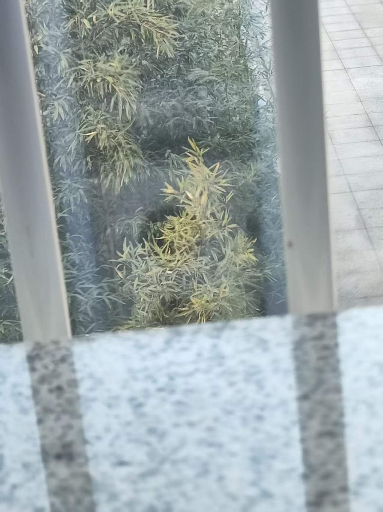

<h1>2026/03/11</h1>
<h2 id="Recent-works">Recent works</h2>

I'm very anxious about my work. Technically, here are some works I should do but have not done yet:

<ol>
<li>FEM learning. I have not finished it; not to mention explaining it to my advisor fluently.</li>
<li>Try to implement secular equations of graphs and the Newton algorithm. Making no progress.</li>
<li>Write a report about the recent works biweekly. Nothing to write yet.
To summarize, I need to do more work and learn more fast.</li>
</ol>
<h2 id="Personal-life">Personal life</h2>

Today, I wake up at 9:30 am but got up until 9:45. I was sitting in my Mathematical Physics class. The material felt pretty basic, but I knew I still needed to learn it. Suddenly, it hit me that I haven't even started reviewing for my transfer exam.

I don't know why, but I found myself thinking about someone I used to like. After letting my mind wander for a while, I comfort myself by convincing myself to change and move on. I guess, in the end, I'm still a bit lonely.

Goofed off at noon and wasted a bunch of time. Finally realized at 4 PM that I needed to head to the library and actually do some work. Here it is. (&gt;_&gt;)

<table>
  <tr>
    <td align="center">
      
    </td>
  </tr>
</table>
Just a random shot. Probably just to prove to myself that I was actually here.
<h1>2026/01/25</h1>
<h2 id="Work-report">Work report</h2>

I report my recent works, including the following:

<ol>
<li>Sturm-Liouville problem on 1D finite domain, with Dirichlet or Neumann boundary conditions.</li>
<li>Generalized eigenproblem of 1D Laplace opretor on complete binary tree.</li>
<li>FEM calculate of those specific 1D problems.</li>
</ol>

My advisor point out that I should focus on the following:

<ol>
<li>I should consider the eigenvalue problem from a weak formulation standpoint or physical standpoint.</li>
<li>I should maintain written documentations of recent works or ideas.</li>
<li>When deriving the theory, I should proceed step by step, without skipping or omitting any steps, and be as detailed as possible.</li>
</ol>

Also I'm asked to do the following:

<ol>
<li>Write a report about the recent works biweekly.</li>
<li>Extend Sturm-Liouville problem to 2D and higher dimensions on $[0,1]^d$, with Dirichlet or Neumann boundary conditions. Calculate it using Firedrake, and compare the results with analytical solutions.</li>
<li>Find the analytical solution of the QG eigenproblem on the complete binary tree, and compare it with the numerical solution.</li>
<li>Read the papers about the FEM on QG and other numercal methods for the eigenproblem.</li>
</ol>
<h2 id="Personal-life-2">Personal life</h2>

Watched the U23 football game last night, I only have 3.5 hours to sleep, so I feel a bit tired today. The game was lost but I find it's a good choice to watch football game to spend time.

After the work report, I enjoy the hotpot alone at a small restaurant. The ZGC streets is down to earth like some normal streets in my hometown but tidy, quiet. Few people are walking around although it's Sunday. I try to take a walk at national library but I am lost. Luckily I find some crows on a tree. Many birds here don't fly, they just sit on the tree.

<table>
  <tr>
    <td align="center">
      
    </td>
    <td align="center">
      
    </td>
  </tr>
</table>

    