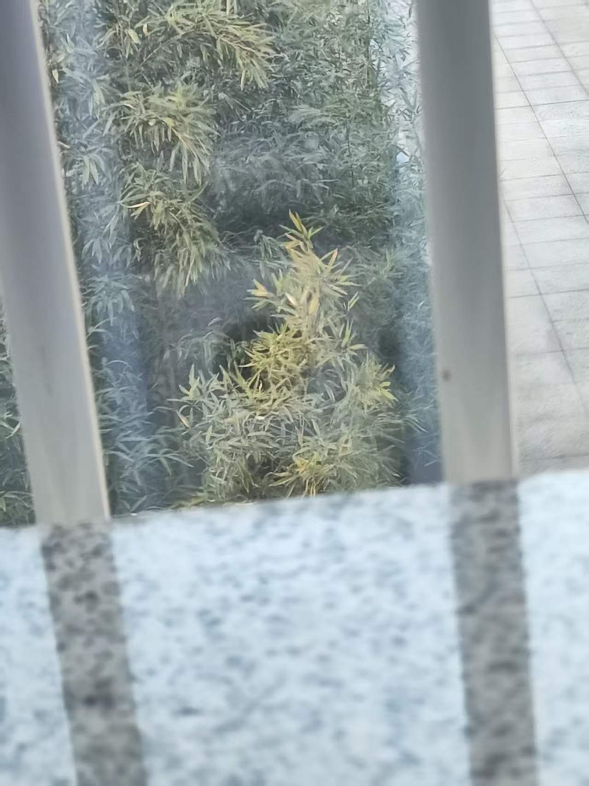

# 2026/11/25

 I decided to control my weight, so I rode about 15 - 20 kilometers today. From where I live, I rode around Yuanmingyuan and I felt good. I encountered a magpie on the road. It didn't fear me; it was so plump (fat) and cute. I love it. Although I haven't finished my work for two weeks now.
 
 

 Also, I decide to continue the blog today again. It costs me much time to deploy it on the new pc.
# 2026/03/11

## Recent works

I'm very anxious about my work. Technically, here are some works I should do but have not done yet:

1. FEM learning. I have not finished it; not to mention explaining it to my advisor fluently.
2. Try to implement secular equations of graphs and the Newton algorithm. Making no progress.
3. Write a report about the recent works biweekly. Nothing to write yet.
   To summarize, I need to do more work and learn more fast.

## Personal life

Today, I wake up at 9:30 am but got up until 9:45. I was sitting in my Mathematical Physics class. The material felt pretty basic, but I knew I still needed to learn it. Suddenly, it hit me that I haven't even started reviewing for my transfer exam.

I don't know why, but I found myself thinking about someone I used to like. After letting my mind wander for a while, I comfort myself by convincing myself to change and move on. I guess, in the end, I'm still a bit lonely.

Goofed off at noon and wasted a bunch of time. Finally realized at 4 PM that I needed to head to the library and actually do some work. Here it is. (>_>)

Just a random shot. Probably just to prove to myself that I was actually here.

# 2026/01/25

## Work report

I report my recent works, including the following:

1. Sturm-Liouville problem on 1D finite domain, with Dirichlet or Neumann boundary conditions.
2. Generalized eigenproblem of 1D Laplace opretor on complete binary tree.
3. FEM calculate of those specific 1D problems.

My advisor point out that I should focus on the following:

1. I should consider the eigenvalue problem from a weak formulation standpoint or physical standpoint.
2. I should maintain written documentations of recent works or ideas.
3. When deriving the theory, I should proceed step by step, without skipping or omitting any steps, and be as detailed as possible.

Also I'm asked to do the following:

1. Write a report about the recent works biweekly.
2. Extend Sturm-Liouville problem to 2D and higher dimensions on $[0,1]^d$, with Dirichlet or Neumann boundary conditions. Calculate it using Firedrake, and compare the results with analytical solutions.
3. Find the analytical solution of the QG eigenproblem on the complete binary tree, and compare it with the numerical solution.
4. Read the papers about the FEM on QG and other numercal methods for the eigenproblem.

## Personal life

Watched the U23 football game last night, I only have 3.5 hours to sleep, so I feel a bit tired today. The game was lost but I find it's a good choice to watch football game to spend time.

After the work report, I enjoy the hotpot alone at a small restaurant. The ZGC streets is down to earth like some normal streets in my hometown but tidy, quiet. Few people are walking around although it's Sunday. I try to take a walk at national library but I am lost. Luckily I find some crows on a tree. Many birds here don't fly, they just sit on the tree.

